# CodeGuard AI architecture

Java 21 modular monolith, Spring Boot 3.5.16, PostgreSQL as the source of truth, RabbitMQ as the delivery mechanism, React as a same-origin session client. Spring Boot 3.5 is selected for compatibility with the required JUnit 5 stack: an actual test run on Boot 4.1.1 failed because Spring 7 calls a JUnit 6-only extension method. Springdoc 2.9.1 matches the Boot 3 generation.

```mermaid
flowchart LR
  GitHub -->|signed original bytes| Webhook
  Webhook -->|one transaction| PostgreSQL
  PostgreSQL -->|durable outbox| Dispatcher
  Dispatcher -->|publisher confirmation| RabbitMQ
  RabbitMQ --> Worker
  Worker -->|installation token| GitHub
  Worker --> Filter[Diff filtering and changed-line mapping]
  Filter --> Policy[Private-code consent and budget check]
  Policy --> AI[Mock or cloud provider]
  AI --> Validate[Validate structured findings]
  Validate --> PostgreSQL
  Browser -->|HttpOnly session + CSRF| API
  API -->|installation and repository access| PostgreSQL
  API -->|explicit publishing approval| GitHub
```

## Boundaries
- `auth`, `security`: browser OAuth session, current user, authorization, CSRF and safe errors.
- `github`: HMAC verification, App JWT / ephemeral installation tokens, authenticated GitHub REST calls and discovery.
- `repository`, `pullrequest`, `review`: persisted domain state, repository policy and scoped APIs.
- `queue`: transactional outbox dispatch, worker lifecycle, bounded retries and recovery.
- `analysis`, `ai`: diff normalization, deterministic static checks, provider abstraction and response validation. Never executes repository code.
- `analytics`: stored measurements and explicitly estimated provider costs.

The browser OAuth token proves user access to installations and repositories; it is never reused as an installation token or returned to JavaScript. App JWTs mint installation tokens only on the server. Each resource query is scoped through the authenticated user's repository grants. Repository settings and publishing require a write/admin grant.

Delivery IDs and `(repository, PR number, head SHA)` are unique. Job state is durable; queue messages contain only job IDs. The database outbox avoids losing jobs between transaction commit and message publication. Workers use conditional state transitions and a lease; stale work can be recovered. Retries are bounded, exponentially delayed, and terminal failures are sent to a dead-letter queue. GitHub publishing uses a persistent reservation and a review marker to reconcile ambiguous outcomes.

## Deployment
One API/worker process initially; scale only with shared PostgreSQL/RabbitMQ and coordinated leases. Use TLS termination, secure cookies, secret mounts, database backups, private network connectivity, and restricted infrastructure credentials. Redis is optional infrastructure, not required for correctness. No public deployment is performed by this repository.
## Publication boundary

Completed reviews can create one durable `review_publications` row per job. Manual requests require CSRF and current repository write permission; automatic requests are inserted atomically with results only when both repository publishing flags are enabled. A scheduled dispatcher claims the row and commits `SENDING` before network work. It revalidates the GitHub diff, consent and authorization, then makes one commit-pinned review POST. Unknown outcomes are never automatically re-posted; read-only reconciliation searches for the unique publication marker. See [publishing lifecycle](docs/PUBLISHING.md) for the availability tradeoff and live checks.

