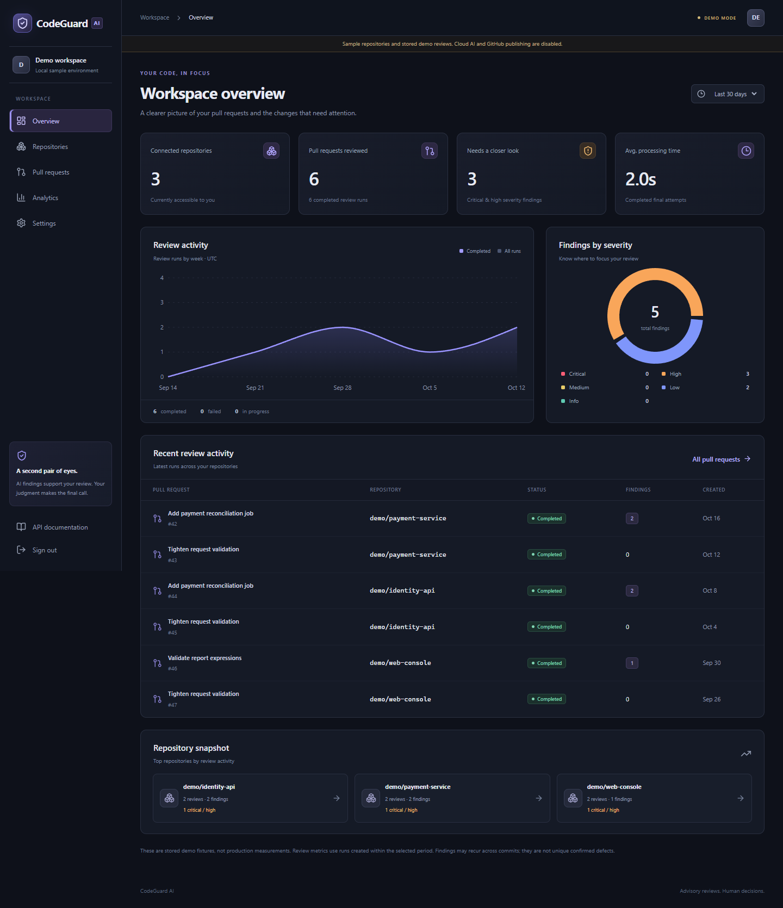
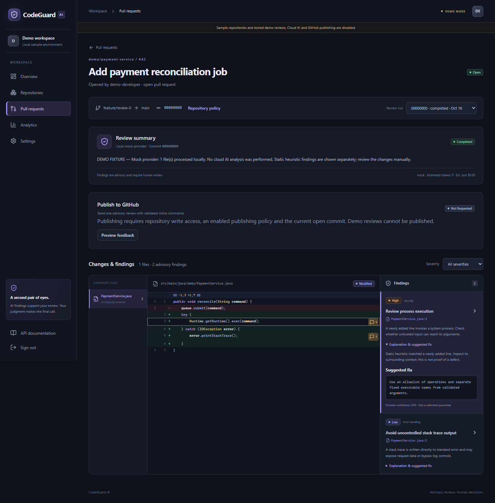

# Local demo walkthrough

Use a separate development database with `DEMO_MODE=true`, `AI_PROVIDER=mock`, `GITHUB_AUTH_ENABLED=false` and `COOKIE_SECURE=false` for local HTTP. Never expose this unauthenticated demo sign-in publicly. Demo mode refuses to start with cloud AI or GitHub OAuth enabled.

With Docker, copy `.env.example` to `.env` and run `docker compose up --build -d`, then open [the local app](http://localhost:3000). This Compose path, including the Nginx proxy and browser journeys, was verified locally on 2026-11-10. The PostgreSQL fallback in [VERIFICATION.md](VERIFICATION.md), adding `DEMO_MODE=true` before starting Java, remains useful when Docker is unavailable; then run `npm.cmd run dev -- --host 127.0.0.1` in `frontend` (use `npm` on Linux/macOS). Vite serves [the source app](http://127.0.0.1:5173).

1. Open **Sign in**, then **Explore the local demo**. The server creates three sample repositories and six completed review fixtures on first sign-in. Repeated sign-in refreshes access without duplicating fixtures.
2. Inspect **Overview**: every number is queried from the database, and the environment is explicitly labeled as sample data. The fixture processing durations and historical dates are illustrative.
3. Open **Repositories**, search for `payment`, and open `demo/payment-service`. Toggle automatic reviews off, save, then restore it. External AI and publishing switches remain disabled for demo repositories.
4. Choose **View pull requests**, then **Add payment reconciliation job**. Inspect added/removed code and click the finding marker at line 3. Read the explanation and suggested fix. Filter findings by severity.
5. Open **Analytics** to inspect weekly runs, categories and usage. Mock reviews have zero AI cost. Findings come from local static heuristics; no cloud analysis is implied.
6. Sign out. Protected routes redirect to sign-in. Mobile layouts expose a sign-out icon in the top bar.

The demo does not exercise live GitHub webhooks, a broker, cloud inference or GitHub publishing. Those require separate live verification. Demo identifiers are negative and cannot identify live GitHub resources. Do not reuse the demo database for a production installation.

## Browser verification

Start the backend and Vite as above, then:

```powershell
cd frontend
$env:CODEGUARD_BROWSER_CHANNEL='chrome' # Use installed Chrome; omit after installing Playwright Chromium.
npm.cmd run test:e2e
```

```sh
cd frontend
npx playwright install --with-deps chromium
npm run test:e2e
```

`CODEGUARD_BASE_URL` can select another local frontend origin. Tests change and restore only a demo repository's local review policy and appearance preference. They must run against a demo environment. Four Chrome journeys passed through Compose on 2026-11-10, covering persistent accessible dark/light appearance, the workflow above, API error recovery, a 390-pixel mobile viewport, and Swagger/OpenAPI authorization.





The six synthetic review dates are refreshed on demo sign-in, keeping them inside the default 30-day walkthrough window even when the database is reused weeks later. Only the exact negative-ID demo repository fixtures are adjusted; live review history is never changed by this path. Metrics remain queries of the stored, explicitly labeled fixture records.
